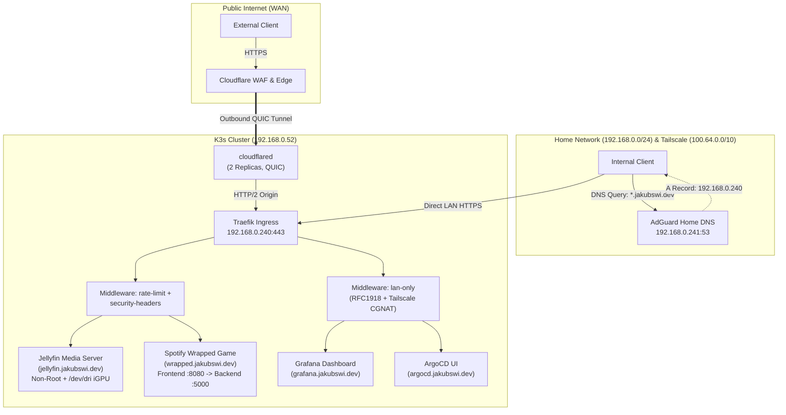
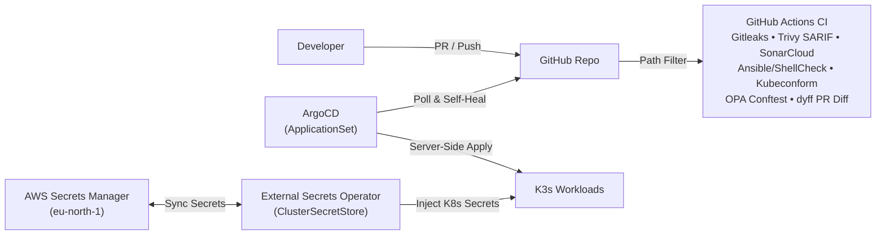

# Bare-Metal K3s GitOps Homelab

Declarative, zero-trust Kubernetes homelab running on bare-metal Ubuntu LTS. Provisioned via **Ansible**, reconciled continuously by **ArgoCD (`ApplicationSet`)**, secured with **Cloudflare Zero Trust Tunnels**, **AWS Secrets Manager (ESO)**, and **Kubernetes NetworkPolicies**, and gated by an automated **DevSecOps CI/CD & Policy-as-Code pipeline**.

---

## Architecture & Traffic Flows

### 1. Split-Horizon Network & Ingress Topology



### 2. GitOps, Policy-as-Code & Secret Management Pipeline



---

## Technology Stack

| Layer | Technology | Implementation Details |
| :--- | :--- | :--- |
| **OS & Host Provisioning** | Ubuntu Server LTS, Ansible | Hardened SSH (`PasswordAuthentication no`), `ufw` default-deny firewall, `fail2ban`, `unattended-upgrades`, LVM root expansion (`+100%FREE`), Tailscale subnet router |
| **Container Orchestration** | K3s | Single-node bare-metal control plane (`192.168.0.52`); built-in Traefik & ServiceLB disabled in favor of GitOps-managed platform charts |
| **GitOps Continuous Delivery** | ArgoCD | App-of-Apps bootstrap (`clusters/home/root-app.yaml`) + `ApplicationSet` Git directory generator (`platform/*`, `apps/*`) with automated pruning, self-healing, and Server-Side Apply |
| **Networking & Ingress** | MetalLB, Traefik, Cloudflared, AdGuard Home | L2 ARP IP pool (`192.168.0.240–250`), HA QUIC Cloudflare Tunnel (zero open router ports), Split-Horizon DNS (`192.168.0.241`), wildcard Let's Encrypt TLS |
| **TLS & Secrets Management** | cert-manager, External Secrets Operator, AWS Secrets Manager | Automated DNS-01 wildcard certificate (`*.jakubswi.dev`) via Cloudflare; zero plaintext secrets in Git via ESO + AWS Secrets Manager (`eu-north-1`) |
| **Workloads** | Jellyfin, Spotify Wrapped Game | Hardware-accelerated Jellyfin (`/dev/dri` Intel QuickSync) and a full-stack multiplayer Spotify guessing game (Go backend + Angular frontend) |
| **Observability** | kube-prometheus-stack, intel-gpu-exporter | Prometheus, Alertmanager, Grafana (custom workload & community dashboards), Intel iGPU metrics DaemonSet, and custom `PrometheusRule` alerts |
| **DevSecOps CI/CD** | GitHub Actions, OPA/Conftest, Trivy, SonarCloud, Renovate | SHA-pinned Actions, Gitleaks, Trivy SARIF + GitHub Security integration, SonarCloud SAST, `kubeconform` CRD validation, Rego v1 policy gates, `dyff` PR diffs |

---

## Security & Defense-in-Depth

* **Zero Inbound Port Forwarding:** Public services (`jellyfin.jakubswi.dev`, `wrapped.jakubswi.dev`) are exposed exclusively through an outbound-only HA QUIC tunnel (`cloudflared`, 2 replicas running as UID `65532` with `readOnlyRootFilesystem: true`) with a catch-all HTTP `404` rule for unmapped hostnames.
* **Control Plane Segregation:** Administrative interfaces (`grafana.jakubswi.dev`, `argocd.jakubswi.dev`) are omitted from the Cloudflare Tunnel ingress map and restricted at Traefik via the `lan-only` IP allowlist (`192.168.0.0/24` LAN, `100.64.0.0/10` Tailscale CGNAT, `10.42.0.0/16` Pod CIDR).
* **East-West Micro-Segmentation (`NetworkPolicy`):**
  * **Jellyfin (`apps/jellyfin`):** Default-deny `NetworkPolicy` permitting ingress only from `traefik` and `monitoring` (`:8096`) and blocking egress to all RFC1918 and CGNAT private ranges.
  * **Spotify Wrapped (`apps/spotify-wrapped`):** Zero-trust `NetworkPolicy` restricting frontend ingress (`:8080`) to `traefik`, backend ingress (`:5000`) exclusively to frontend pods, and egress to CoreDNS (`:53`) and external HTTPS (`:443`).
* **Hardened Pod & Container Security Contexts:** Workloads enforce `runAsNonRoot: true`, `readOnlyRootFilesystem: true` (with scoped `emptyDir` scratch mounts), `allowPrivilegeEscalation: false`, `seccompProfile: RuntimeDefault`, `automountServiceAccountToken: false`, and `capabilities.drop: ["ALL"]`.
* **Policy-as-Code & Supply Chain Integrity:**
  * **OPA / Conftest (`policy/security.rego`):** Enforces Rego v1 rules across all rendered Helm manifests to reject plaintext `Secret` objects (requiring `ExternalSecret` resources) and block `:latest` or untagged container images.
  * **Pinned CI Dependencies:** All third-party GitHub Actions in `.github/workflows/ci.yaml` are pinned to immutable 40-character commit SHAs and maintained via `./scripts/pin-actions.sh`.

---

## CI/CD Pipeline Stages (`.github/workflows/ci.yaml`)

| Job | Trigger Condition | Checks Executed |
| :--- | :--- | :--- |
| **Detect Changed Paths** | All PRs, `master` pushes, `workflow_dispatch` | `dorny/paths-filter` classifies changes across `helm`, `ansible`, and `scripts` |
| **Secrets, SAST & Misconfig Scan** | Always | `gitleaks` secret scan, Helm chart rendering, `trivy` Kubernetes misconfiguration scan (uploads SARIF to GitHub Security + enforces `CRITICAL,HIGH` gate), and **SonarCloud** static analysis |
| **Lint Ansible & Shell Scripts** | Changes in `ansible/**`, `scripts/**`, or `bootstrap/**` | `shellcheck` across all tracked `.sh` files, `ansible-lint`, and `ansible-playbook --syntax-check` |
| **Render Charts, Kubeconform & Policy Check** | Changes in `apps/**`, `platform/**`, `clusters/**`, `policy/**`, or `master` push | `yamllint`, `kubeconform` strict validation against upstream CRD schemas, and `conftest test` against `policy/security.rego` |
| **Post Rendered Manifest Diff on PR** | Pull requests modifying charts or manifests | Renders `base` vs. `pr` Helm manifests and posts a collapsible `dyff` resource diff comment on the PR |

---

## Repository Structure

```text
.
├── .github/workflows/
│   └── ci.yaml               # Multi-stage GitOps CI, security scanning, OPA & PR diff pipeline
├── ansible/                  # Host hardening (UFW, fail2ban, SSH), LVM resize, K3s & Tailscale
├── apps/
│   ├── adguard/              # Split-Horizon DNS server (LoadBalancer: 192.168.0.241)
│   ├── jellyfin/             # Media server with Intel QuickSync (/dev/dri) & NetworkPolicy
│   └── spotify-wrapped/      # Full-stack multiplayer game (Go + Angular), ESO & NetworkPolicy
├── bootstrap/
│   └── bootstrap.sh          # One-time ArgoCD installation & root-app entrypoint
├── clusters/home/
│   ├── apps.yaml             # ArgoCD ApplicationSet auto-discovering platform/* and apps/*
│   ├── argocd-ingress.yaml   # LAN-only HTTPS ingress for ArgoCD UI
│   └── root-app.yaml         # App-of-Apps root Application
├── platform/
│   ├── cert-manager/         # Let's Encrypt DNS-01 ClusterIssuer via Cloudflare
│   ├── cloudflared/          # HA Cloudflare Zero Trust Tunnel deployment
│   ├── external-secrets/     # ESO controller & AWS Secrets Manager ClusterSecretStore
│   ├── metallb/              # Bare-metal L2 LoadBalancer IP pool (192.168.0.240–250)
│   ├── monitoring/           # kube-prometheus-stack, intel-gpu-exporter, dashboards & alerts
│   └── traefik/              # Ingress controller (192.168.0.240), wildcard TLS & middlewares
├── policy/
│   └── security.rego         # OPA/Conftest Rego v1 guardrails (no plaintext Secrets or :latest)
├── scripts/
│   ├── configure.sh          # Bootstrap domain, GitHub user, and LAN subnet replacement
│   ├── helm-deps.sh          # Update Helm subchart dependencies and Chart.lock files
│   ├── pin-actions.sh        # Resolve and pin GitHub Actions to 40-char commit SHAs
│   ├── render-charts.sh      # Auto-register Helm repos, build deps, and render manifests
│   └── validate.sh           # Render all charts/manifests and run strict kubeconform checks
├── Makefile                  # Developer & operator task runner
├── renovate.json             # Automated Helm, Kubernetes, and GitHub Actions dependency PRs
├── sonar-project.properties  # SonarCloud project configuration
└── .trivyignore              # Documented security exceptions for cluster-level operators
```

---

## Local Validation & Operations

```bash
# Run YAML and Ansible linters locally
make lint

# Render all Helm charts and validate schemas with kubeconform
make validate

# Render charts and test against OPA/Conftest security policies
./scripts/render-charts.sh .rendered
conftest test .rendered/*.yaml --policy policy/

# Re-pin GitHub Actions to 40-character commit SHAs after workflow updates
./scripts/pin-actions.sh
```

---

## Disaster Recovery (Bare Metal to Production)

```bash
# 1. Harden Ubuntu host, expand LVM root volume, and install K3s + Tailscale
make ansible-deps
make provision

# 2. Inject the single bootstrap IAM credential for External Secrets Operator
kubectl create namespace external-secrets
kubectl create secret generic awssm-secret -n external-secrets \
  --from-literal=access-key="<AWS_ACCESS_KEY_ID>" \
  --from-literal=secret-access-key="<AWS_SECRET_ACCESS_KEY>"

# 3. Bootstrap ArgoCD; ApplicationSet reconciles all platform/* and apps/* workloads
make bootstrap
```
