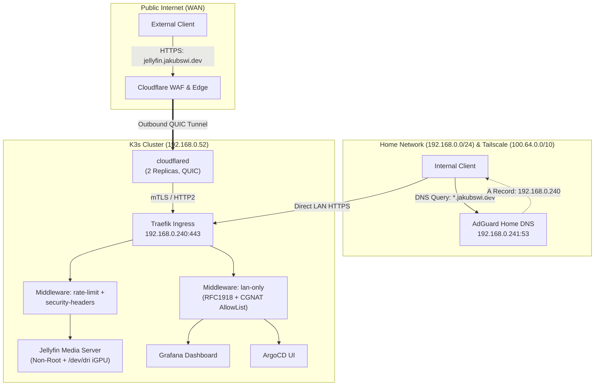
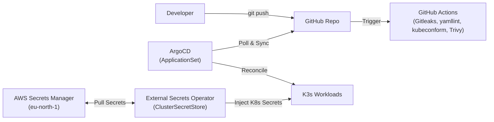

# Bare-Metal K3s GitOps Homelab

Declarative, zero-trust Kubernetes homelab running on bare-metal Ubuntu LTS. Provisioned via **Ansible**, reconciled via **ArgoCD (App-of-Apps)**, and secured with **Cloudflare Zero Trust Tunnels**, **AWS Secrets Manager (ESO)**, and **Kubernetes NetworkPolicies**.

---

## Architecture & Traffic Flows

### 1. Split-Horizon Network & Ingress Topology



### 2. GitOps & Secret Management Pipeline



---

## Technology Stack

| Layer | Technology | Implementation Details |
| :--- | :--- | :--- |
| **OS & Host Provisioning** | Ubuntu Server LTS, Ansible | Automated SSH hardening, `ufw` default-deny firewall, `fail2ban`, LVM root expansion (`+100%FREE`), Tailscale subnet router |
| **Container Orchestration** | K3s | Single-node control plane; built-in Traefik & ServiceLB disabled in favor of GitOps-managed platform stack |
| **GitOps Continuous Delivery** | ArgoCD | App-of-Apps bootstrap + `ApplicationSet` Git directory generator (`platform/*`, `apps/*`) with automated pruning and self-healing |
| **Networking & Load Balancing** | MetalLB, Traefik, Cloudflared | L2 ARP pool (`192.168.0.240–250`), QUIC Cloudflare Tunnel (zero open router ports), Split-Horizon DNS via AdGuard Home (`192.168.0.241`) |
| **TLS & Secrets Management** | cert-manager, External Secrets (ESO), AWS Secrets Manager | Wildcard Let's Encrypt DNS-01 certificates (`*.jakubswi.dev`); zero secrets in Git via ESO + AWS Secrets Manager (`eu-north-1`) |
| **Observability** | kube-prometheus-stack | Prometheus, Alertmanager, Grafana, ServiceMonitors, and custom `PrometheusRule` alerts |
| **CI/CD & Automation** | GitHub Actions, Renovate | Pre-commit hooks, `gitleaks`, `yamllint`, `kubeconform` CRD validation, `trivy` misconfiguration scanning, automated dependency PRs |

---

## Security & Defense-in-Depth

* **Zero Inbound Port Forwarding:** All WAN traffic traverses an outbound-only encrypted QUIC tunnel (`cloudflared` running as UID `65532` with `readOnlyRootFilesystem: true`).
* **Control Plane Segregation:** Internal services (`grafana.jakubswi.dev`, `argocd.jakubswi.dev`) are excluded from the Cloudflare Tunnel config and protected at the ingress layer by Traefik's `lan-only` IP allowlist (`192.168.0.0/24`, `100.64.0.0/10`).
* **East-West Micro-Segmentation:** Jellyfin is isolated via a default-deny Kubernetes `NetworkPolicy` (`apps/jellyfin/templates/networkpolicy.yaml`) that permits ingress strictly from `traefik` and `monitoring` (`:8096`) and blocks egress to all RFC1918 private LAN subnets.
* **Pod Security Contexts:** Workloads enforce `runAsNonRoot: true`, `allowPrivilegeEscalation: false`, `seccompProfile: RuntimeDefault`, and drop all Linux capabilities (`drop: ["ALL"]`).

---

## Repository Structure

```text
.
├── ansible/                  # OS hardening, UFW rules, K3s & Tailscale provisioning
├── apps/
│   ├── adguard/              # Split-Horizon DNS server (LoadBalancer: 192.168.0.241)
│   └── jellyfin/             # Media server with Intel QuickSync (/dev/dri) & NetworkPolicy
├── bootstrap/                # One-time ArgoCD installation & root-app entrypoint
├── clusters/home/            # ArgoCD Root Application & ApplicationSet definitions
├── platform/
│   ├── argocd-ingress/       # LAN-only HTTPS ingress for ArgoCD
│   ├── cert-manager/         # Let's Encrypt DNS-01 ClusterIssuer via Cloudflare
│   ├── cloudflared/          # HA Cloudflare Zero Trust Tunnel deployment
│   ├── external-secrets/     # ESO controller & AWS Secrets Manager ClusterSecretStore
│   ├── metallb/              # Bare-metal L2 LoadBalancer IP pool (192.168.0.240-250)
│   ├── monitoring/           # Prometheus, Grafana, Alertmanager & PrometheusRules
│   └── traefik/              # Ingress controller (192.168.0.240), Wildcard TLS & Middlewares
└── scripts/                  # Validation (kubeconform), Helm lock updater & media sync tools
```

---

## Disaster Recovery (Bare Metal to Production)

```bash
# 1. Harden Ubuntu host, expand LVM, and install K3s + Tailscale
make ansible-deps
make provision

# 2. Inject the single bootstrap IAM credential for External Secrets Operator
kubectl create namespace external-secrets
kubectl create secret generic awssm-secret -n external-secrets \
  --from-literal=access-key="<AWS_ACCESS_KEY_ID>" \
  --from-literal=secret-access-key="<AWS_SECRET_ACCESS_KEY>"

# 3. Bootstrap ArgoCD; ApplicationSet reconciles all platform/* and apps/* workloads
make bootstrap
```
